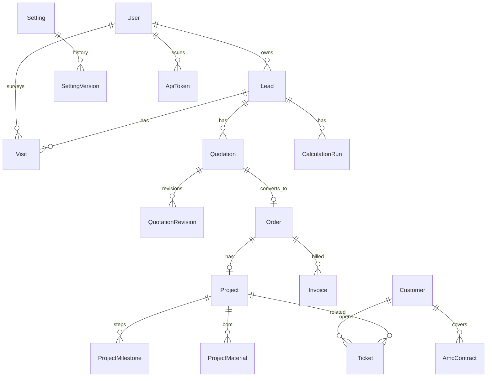

# Solar CRM Management System

Rootflash Technology first-round assignment prototype: a **Laravel + Filament + MySQL** Solar CRM for leads → site visits → hybrid/investment/EV calculators → quotations → projects → inventory → tickets/AMC, with dynamic Settings, Demo messaging, and a scoped REST API.

**Disclaimer:** Demo data and credentials are **fictional / local-only**. Calculator and tariff outputs are **indicative estimates, not engineering certification**. WhatsApp/email outbound defaults to **SIMULATED – not delivered**.

---

## Stack (exact installed versions)

| Layer | Version |
|-------|---------|
| PHP | 8.3.x (developed on 8.3.33) |
| Composer | 2.8.x |
| Node / npm | 22.x / 10.x (for Vite assets) |
| Laravel | **13.38.0** |
| Filament | **5.10.3** |
| Livewire | **4.4.8** |
| PHPUnit | **12.5.x** |
| Dompdf (`barryvdh/laravel-dompdf`) | **3.1.2** |
| QR (`endroid/qr-code`) | **6.0.9** |
| MySQL | **8.0** via Docker `solar_crm_mysql` on host port **3308** |
| Frontend tooling | Vite 8 + Tailwind 4 (app CSS); Filament ships its own panel assets |

Details: [`docs/stack-decisions.md`](docs/stack-decisions.md).

---

## Architecture

### Modules (Filament admin)

| Area | Capabilities |
|------|----------------|
| Sales | Leads, customers, quotations, tasks |
| Field | Site visits, survey/docs, visit PDF |
| Calculators | Hybrid, investment, EV (immutable `calculation_runs` snapshots) |
| Operations | Orders, projects (milestones, materials/BOM) |
| Inventory | Products, warehouses, vendors, low stock |
| Finance | Invoices / payments (gateway labelled Simulated) |
| Service | Tickets, AMC contracts |
| Reports / Dashboard | KPIs, report hub + CSV export |
| Administration | Settings, lookups, communications, API tokens, message logs, branches |

### Key service classes (`app/Services`)

| Service | Role |
|---------|------|
| `SettingsService` | Versioned settings + cache + audit redaction |
| `NumberingService` | Locked sequential references (lead/quote/…) |
| `DocumentService` | Private-disk uploads, MIME/size checks, authorized download |
| `Calculators\HybridCalculatorService` | Hybrid sizing / savings / CAPEX |
| `Calculators\InvestmentCalculatorService` | Cashflow / payback / ROI |
| `Calculators\EvCalculatorService` | EV charging P&L |
| `QuotationService` / `QuotationTotals` | Quote workflow + GST totals |
| `ConvertQuotationToProject` | Quote → order/project |
| `StockService` / `AllocationService` | Stock states + project allocation |
| `TicketService` / `AmcService` | Service workflows |
| `MessageService` | WhatsApp/email Demo simulation + logs |
| `AuditLogger` | Action audit with secret redaction |
| Report / dashboard query services | Scoped KPI and exports |

Authorization: custom `roles` / `permissions` / `role_permissions` + policies + `RecordScoping` (executives/surveyors see assigned records).

### Data model (summary)



Text relationships: Lead → Visit / CalculationRun / Quotation → (accepted) Order → Project (+ milestones/materials) → Invoice; Customer → Ticket / AMC; Settings rows versioned; Documents morph to Visit/Lead/etc.; MessageLog + AuditLog for communications and mutations.

---

## Prerequisites

- PHP **8.3+** with extensions Laravel needs (`pdo_mysql`, `mbstring`, `openssl`, `tokenizer`, `xml`, `ctype`, `json`, `bcmath`, `fileinfo`, `gd` or `imagick` helpful for images/PDF)
- Composer 2
- Node 20+ / npm (for `npm install` + `npm run build`)
- Docker (recommended) **or** MySQL 8 reachable on the host
- Git

---

## Database setup (Docker MySQL — recommended)

Dedicated container so host MySQL DBs are untouched:

```bash
docker start solar_crm_mysql 2>/dev/null || docker run -d --name solar_crm_mysql \
  -e MYSQL_ROOT_PASSWORD=solar_crm_root_local \
  -e MYSQL_DATABASE=solar_crm \
  -e MYSQL_USER=solar_crm \
  -e MYSQL_PASSWORD=solar_crm_pass_local \
  -p 3308:3306 mysql:8.0
```

Wait until MySQL accepts connections (`docker logs solar_crm_mysql` or retry migrate).

Default app DB connection (see `.env.example`):

| Variable | Local demo value |
|----------|------------------|
| `DB_HOST` | `127.0.0.1` |
| `DB_PORT` | `3308` |
| `DB_DATABASE` | `solar_crm` |
| `DB_USERNAME` | `solar_crm` |
| `DB_PASSWORD` | `solar_crm_pass_local` |

---

## Environment variables

Copy **only** from [`.env.example`](.env.example). **Never commit `.env`.**

Important groups:

| Group | Keys (examples) | Notes |
|-------|-----------------|-------|
| App | `APP_NAME`, `APP_URL`, `APP_KEY`, `APP_DEBUG` | `key:generate` fills `APP_KEY` |
| Database | `DB_*` | Match Docker above |
| Session / queue / cache | `SESSION_DRIVER=database`, `QUEUE_CONNECTION=database`, `CACHE_STORE=database` | Tables created by migrations |
| Mail | `MAIL_*` | Default `log` mailer (Demo) |
| WhatsApp (optional live) | `WHATSAPP_TOKEN`, `WHATSAPP_PHONE_NUMBER_ID`, … | Commented in `.env.example`; UI never shows secrets |
| Vite | `VITE_APP_NAME` | Frontend build |

Secrets belong in `.env` / secure store — not Settings UI, not git, not audit plaintext (redacted).

---

## Install (clean machine)

From a clone of this repository:

```bash
git clone <repo-url> solar-crm && cd solar-crm

cp .env.example .env
# Confirm DB_* match your MySQL (Docker defaults already set in .env.example)

composer install
npm install
npm run build

php artisan key:generate
php artisan migrate:fresh --seed
php artisan storage:link

php artisan serve
# → http://127.0.0.1:8000/admin/login
```

Optional convenience (still run `npm`/`migrate:fresh --seed` as above if you need demo data): `composer run setup` runs install + key + migrate + npm build (uses `migrate`, not necessarily fresh seed — prefer the explicit sequence for reviewers).

Reload fictional demo data anytime:

```bash
php artisan demo:reset --force
# equivalent: php artisan migrate:fresh --seed
```

---

## Demo roles & credentials (fictional / local-only)

Shared password: `Password1!`

| Role | Email |
|------|-------|
| Super Admin | `admin@solar-crm.test` |
| Sales Manager | `manager@solar-crm.test` |
| Sales Executive | `executive@solar-crm.test` |
| Surveyor / Engineer | `surveyor@solar-crm.test` |
| Project Manager / Operations | `pm@solar-crm.test` |
| Inventory / Finance / Service | `ops@solar-crm.test` |
| Deactivated (login blocked) | `inactive@solar-crm.test` |

**Golden linked walkthrough:** `LEAD-2026-0003` → visit → calc → accepted quote → order/project → invoice → ticket/AMC. Full click path: [`docs/demo-script.md`](docs/demo-script.md). UI checklist: [`docs/ui-workflow-checklist.md`](docs/ui-workflow-checklist.md).

---

## How to run tests

```bash
php artisan test --compact
# or
php artisan test --testsuite=Feature
```

MySQL-only concurrency tests (require Docker DB; may skip on SQLite):

```bash
DB_CONNECTION=mysql DB_HOST=127.0.0.1 DB_PORT=3308 \
  DB_DATABASE=solar_crm DB_USERNAME=solar_crm DB_PASSWORD=solar_crm_pass_local \
  php artisan test --compact --filter=MysqlConcurrency
```

Calculation / security / acceptance evidence: `docs/calculation-verification.md`, `docs/security-verification.md`, `docs/acceptance-evidence.md`.

---

## Queue & scheduler

| Item | How |
|------|-----|
| Queue | `QUEUE_CONNECTION=database` — run `php artisan queue:work` when processing jobs |
| Scheduler | `routes/console.php`: `amc:renewal-reminders` daily 08:00; `reminders:dispatch` every 15 minutes |
| Cron (prod) | `* * * * * cd /path/to/app && php artisan schedule:run >> /dev/null 2>&1` |

Without a worker/scheduler, queue jobs and timed reminders will not run (seeded UI data still works).

Manual reminder commands:

```bash
php artisan amc:renewal-reminders
php artisan reminders:dispatch
```

---

## How to test major flows

| Flow | How |
|------|-----|
| Auth / RBAC | Login as executive vs admin; Settings forbidden for executive ([`docs/demo-script.md`](docs/demo-script.md) §1) |
| Leads / follow-ups | Sales → Leads; filter/search; open Demo Lead 1–3 |
| Visit | Field → Visits → completed `VIS-2026-0003` |
| Hybrid calc | Calculators → Hybrid; Calculate & save snapshot; Settings change → old snapshot immutable |
| Quotation | Quotations → accepted `QUO-2026-0005`; PDF; WhatsApp share → SIMULATED |
| Project / stock | My Orders → Project milestones & materials (shortage demo line) |
| Tickets / AMC | Service menus; near-renewal AMC |
| Dashboard / reports | KPI deep links; Reports → export CSV |
| API | Enable API in Settings; create token; `GET /api/v1/leads` — [`docs/api.md`](docs/api.md) |

---

## Settings walkthrough

Administration → **Settings** (`/admin/manage-settings`): tabs for Branding, Security, Numbering, Calculators, Inventory, Projects, Service, Lists & workflows, Regional & finance, Documents, Integrations, API & system.

- Branding name/logo → nav / PDFs after refresh (SET-01).
- Calculator defaults affect **new** runs only (SET-04).
- Integrations show Configured / Not configured — **no secret fields**.
- Lookups: Administration → Lookups / dropdowns (SET-03).

Evidence: [`docs/acceptance-evidence.md`](docs/acceptance-evidence.md).

---

## WhatsApp / email (Demo vs production)

**Default:** Demo / simulated. Message status `demo_simulated` or `failed` only. UI badges **SIMULATED – not delivered**.

**Production-oriented notes (not fully wired in this build):**

1. Put provider secrets in `.env` (`WHATSAPP_*`, SMTP `MAIL_*`) — never in Settings values stored as plaintext in UI.
2. Flip Settings messaging mode only after a tested provider client exists (`Configured WhatsApp provider client` is **Not implemented** — stub only).
3. Do not invent delivery statuses (`queued`/`sent`/`delivered`) without a real provider response.
4. Webhooks: **Not implemented**.

---

## API usage

See [`docs/api.md`](docs/api.md).

```bash
# After enabling API + creating a token in the admin UI:
curl -s -H "Authorization: Bearer rf_…" \
  "http://127.0.0.1:8000/api/v1/leads?per_page=10"
```

Rate limit: 60/minute. Empty token abilities fail closed.

---

## Backup plan

Manual `mysqldump` + `storage/app` + secure `.env` backup. No automated cloud backup in this build. Full steps: [`docs/backup-plan.md`](docs/backup-plan.md).

---

## Deployment notes

- Target PHP 8.3+, MySQL 8, HTTPS reverse proxy, `APP_DEBUG=false`, strong `APP_KEY`.
- Run `composer install --no-dev -o`, `npm ci && npm run build`, `php artisan migrate --force`, `storage:link`, queue worker + cron for scheduler.
- Re-enable Composer TLS if disabled on the build agent.
- Optional: [Laravel Cloud](https://cloud.laravel.com/) — see project skill `deploying-to-cloud` when using Cloud CLI.
- Do not deploy with demo passwords or `APP_DEBUG=true`.

---

## Security notes

- Server-side policies + `RecordScoping`; passwords hashed (bcrypt).
- Uploads: extension allowlist, MIME-by-content, size limit, path-safe storage names.
- Public quote verify uses opaque `public_token` + rate limit; minimal fields only.
- Audit / message logs redact secrets by key name.
- No `.env` in git. Details: [`docs/security-verification.md`](docs/security-verification.md).

---

## Known limitations

See [`docs/known-limitations.md`](docs/known-limitations.md). Highlights: Demo messaging; payment gateway simulated; NPV/IRR not implemented; Filament User/Role CRUD UI not built; optional 2FA not built; scheduler/queue need OS processes.

---

## Future work

- Live WhatsApp/SMTP providers + webhooks with tested clients  
- Customer portal / richer billing milestones  
- User & role admin UI; optional 2FA / lockout  
- Automated off-site backups  
- NPV/IRR investment extras  
- Hardening Composer TLS and production observability  

---

## Project docs index

| Doc | Purpose |
|-----|---------|
| `docs/demo-script.md` | Live walkthrough |
| `docs/calculation-spec.md` / `calculation-verification.md` | Formulas + hand math |
| `docs/acceptance-evidence.md` | AT/SET status |
| `docs/security-verification.md` | AuthZ matrix |
| `docs/ui-workflow-checklist.md` | Responsive / UX |
| `docs/feature-status.md` / `requirements-matrix.csv` | Requirement tracking |
| `docs/api.md` / `backup-plan.md` | API & backups |
| `docs/project-clock.md` | 30h clock (awaiting receipt timestamp) |

---

## License / assignment

Prototype for evaluation under the Rootflash Solar CRM assignment brief. Not a production support contract.
